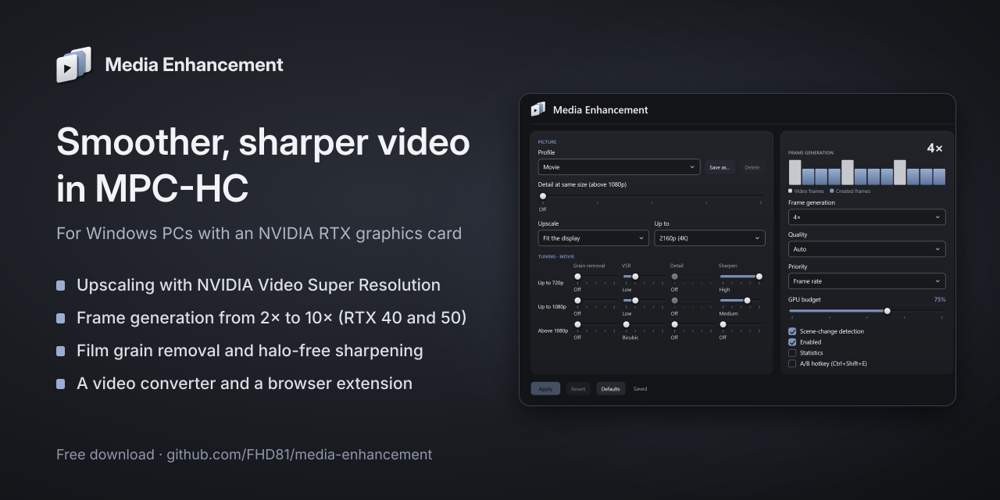

### Media Enhancement

Smoother, sharper video in MPC-HC on Windows PCs with an NVIDIA RTX graphics card.

- **Upscaling** to your display with NVIDIA Video Super Resolution.
- **Frame generation** from 2× to 10×, or matched to your display's refresh rate (RTX 40 and 50 series).
- **Film grain removal**, and **sharpening** that sharpens edges without halos.
- **Converter** (preview): the same enhancements in a new video file that plays anywhere.
- **Browser extension** for Chrome, Edge and Firefox: upscaling and frame generation for video in web pages, through WebGPU, so not only on NVIDIA cards.

**[Download the latest release](https://github.com/FHD81/media-enhancement/releases/latest)** · [Project page](https://github.com/FHD81/media-enhancement) · [Announcements](https://github.com/FHD81/media-enhancement/discussions/categories/announcements)

Free. An independent project, not affiliated with NVIDIA or the MPC-HC project.
